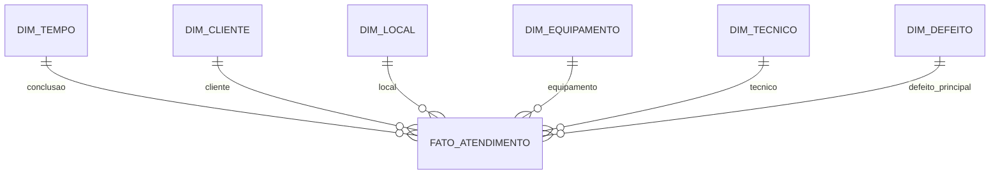

# Data Warehouse: esquema estrela

Granularidade: uma linha por ordem de serviço concluída.

**Métricas:** duração em horas, quantidade de peças, custos em centavos e indicador de atraso (0/1).

Uma tabela auxiliar OS–defeito–peça preserva múltiplos itens para a mineração, sem duplicar métricas da fato.
